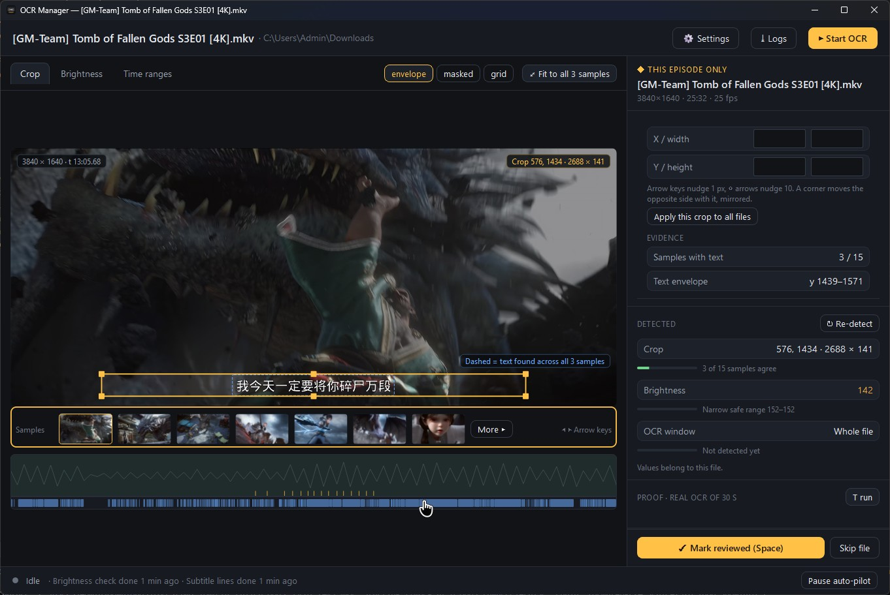

<p align="center">
  
  <h1 align="center">OCR Manager - DirectML version</h1>
  <p align="center">
    Unburn a whole season of hardsubbed episodes. OCR Manager tunes itself to each file, reads every line, and hands you timed <code>.ass</code> subtitles with positioned labels.
    <br>
  </p>

  <p align="center">
    <a href="https://github.com/FlamingWater35/ocr-manager-directml/releases">
      
    </a>
  </p>

  <p align="center">
    
    
    
    
    
  </p>
</p>

---

<p align="center">
  
  <br />
  <em>OCR Manager reviewing an episode: crop box, sample filmstrip, brightness curve and keep ranges</em>
</p>

---

## 📑 Table of Contents

- [✨ About & Key Features](#-about--key-features)
- [⚙️ Settings Reference](#️-settings-reference)
- [🚀 Quick Setup](#-quick-setup)
  - [📦 Pre-built Releases](#-pre-built-releases-recommended)
  - [💻 Development Setup (From Source)](#-development-setup-from-source)
  - [🔨 Building the Windows Release](#-building-the-windows-release)
- [🎯 Usage Examples](#-usage-examples)
- [⚡ Performance & Tuning](#-performance--tuning)
- [🛠️ Troubleshooting](#️-troubleshooting)
- [🙏 Credits](#-credits)

---

## ✨ About & Key Features

> **This fork targets AMD and Intel GPUs first.** OCR runs on DirectML, which
> is Microsoft's vendor-neutral DirectX 12 compute layer, so any DX12 adapter
> can do the work — but AMD Radeon and Intel Arc / Iris Xe are the primary
> targets here, not an afterthought. There is no CUDA dependency and no
> `nvidia-smi` anywhere: one `onnxruntime-directml` wheel, one code path, the
> same models on every vendor. NVIDIA cards are supported by the same path
> (DirectML runs on them too); they are simply not what this fork is aimed at.

OCR Manager reads hardcoded (burned-in) subtitles out of video and writes timed `.ass` files. It is built for **seasons**, not single files: open a folder of episodes and it detects each file's crop box, brightness threshold and intro/outro ranges on its own, then OCRs only the frames that carry text.

- **Windows x64, self-contained**: PyQt6 desktop app with a bundled ffmpeg, bundled OCR engine and bundled PP-OCRv6 models. Nothing is installed on first run, and no CUDA toolkit, NVIDIA driver build or `nvidia-smi` is involved anywhere.
- **DirectML acceleration**: RapidOCR runs the PP-OCRv6 detection, classification and recognition models on ONNX Runtime's `DmlExecutionProvider`, so any DirectX 12 adapter (NVIDIA, AMD or Intel) does the work. Without one it falls back to the CPU and still works.
- **Auto-pilot detection**: crop box (speech-guided, union-of-frames rather than tightest-frame), brightness threshold (dark scene / bright background / thin strokes / two lines / subtitle line), keep ranges (intro+outro matched across episodes by audio), and subtitle-line sampling — all per folder, all re-runnable per file with **↻ Re-detect**.
- **Positioned labels**: detects text *outside* the dialogue crop (name cards, place names, on-screen captions) and writes them as positioned `.ass` events, with `ass-qafix` post-processing.
- **Exact frame timing**: video is decoded by piping raw frames out of ffmpeg, and every frame's PTS is read from ffmpeg's own `showinfo` output rather than estimated from an ordinal, so a subtitle lands on the frame it was read from.
- **Three model sizes**: `tiny`, `small` (default) and `medium` PP-OCRv6, shipped with the app and switchable per folder. No download, no restart.
- **A real review workbench**: queue with filter chips and badges, crop canvas with sample filmstrip, brightness curve with draggable threshold, keep-range timeline, per-file proof OCR, and a full debug log of every decision.
- **Detailed logging**: `%LOCALAPPDATA%\ocr-manager\logs\ocr-manager.log` records the decoder's probe and seeks, every OCR read with its scores, each crop probe and the score it needed to accept a box, and the label scan's phases.

---

## ⚙️ Settings Reference

Per-folder settings live in **⚙ Folder settings**. A folder's settings apply to every file in it; an episode opened on its own keeps its own copy.

<details>
<summary><strong>📋 Click to expand the full settings table</strong></summary>

<br>

| Setting | Description | Tuning Tip |
| :--- | :--- | :--- |
| **Dialogue subtitles** | Read the subtitle lines inside each file's crop box. | On for anything with hardsubs. Turning both extraction toggles off disables **Start**. |
| **Positioned labels / nameplates** | Read short captions and name cards placed elsewhere in the frame, exported as positioned `.ass` events. | Costs a second detection pass over the whole frame. Off if you only want dialogue. |
| **Language** | The subtitles' language, from 100+ codes (type to filter). | Pick the actual language: the wrong route is the most common cause of garbage text. |
| **Model size** | PP-OCRv6 model used for detection and recognition. | `Tiny` = fastest, lowest accuracy. `Small` (default) = balanced. `Medium` = most accurate, noticeably slower. All three ship with the app, so switching never downloads anything. |
| **Create subfolder** | Write subtitles into a language-named folder (`zh/EP01.zh.ass`) instead of next to the video. | Off when your player already scans the video's own folder. |
| **Confidence threshold** | Minimum confidence for a reading to be kept; a frame below it is retried. | Lower = catches more text, more typos. Higher = stricter, more frames retried. |
| **Merge similar lines above** | Neighbouring readings at least this alike become one subtitle line. | Raise if the same line is emitted twice with slight differences. |
| **Similar-frame threshold** | A frame whose pixels changed less than this is not read again. | Lower = skips more frames (faster, riskier on animated signs). Higher = reads more frames. |
| **Minimum / Maximum label duration** | Labels visible for less / more time than this are dropped. | Tighten `Maximum` if a permanent watermark is being read as a nameplate. |
| **Minimum label confidence** | Label readings below this are discarded. | Raise on noisy backgrounds. |
| **Parallel files** | How many episodes are OCR'd at the same time during a run. | 2–4 on a mid-range machine. Each parallel file is its own ffmpeg pipe plus its own OCR session. |
| **Run detections when a folder opens** | Find crop, brightness and intro/outro ranges without being asked. | Off makes opening a large folder instant; you then press **↻ Re-detect** per file. |
| **Full brightness detection on the first N files** | Later files start from the shared plateau instead of a full scan. | Raise if episodes differ a lot in brightness; lower for a faster open. |
| **Minimum repeating segment** | Audio repeats shorter than this are not treated as an intro or outro. | Raise if a recurring sound effect is being matched as an intro. |
| **Merge repeating silences** | Bridge silent gaps that sit at the same spot in several files. | Helps shows with a silent beat inside the opening. |
| **Crop width / vertical padding / minimum height / subtitle band start** | The rules a *detected* crop box is fitted to. | Leave alone unless your subtitles are unusually narrow, tall or high on screen. |
| **Mask regions** | Rectangles blacked out before labels are searched (channel logos). | Add one over a persistent logo that keeps being read. |

</details>

### Keyboard shortcuts

| Key | Action |
| :--- | :--- |
| `Ctrl+O` | Open an episode |
| `Ctrl+Shift+O` | Open a folder of episodes |
| `Space` | Mark reviewed / not reviewed |
| `T` | Test OCR on 30 s of the current file |
| `Ctrl+Q` | Quit |
| `←` `→` / `↑` `↓` | Nudge the crop box by 1 px (hold `Shift` for 10) |
| `Delete` | Remove the focused recent file on the welcome screen |

---

## 🚀 Quick Setup

### 📦 Pre-built Releases (Recommended)

Get started instantly from the [Releases page](https://github.com/FlamingWater35/ocr-manager-directml/releases):

| File | What it is |
| :--- | :--- |
| `ocr-manager-<version>-win.exe` | Per-user installer. No admin rights needed. |
| `ocr-manager-<version>-win.zip` | Portable folder. Unzip anywhere and run `ocr-manager.exe`. |

Each release also lists `SHA256SUMS.txt` so you can verify the download.

**Requirements:** Windows 10 build 18362 or newer / Windows 11, x64. Any DirectX 12 capable graphics adapter for GPU OCR; the CPU fallback works without one. Nothing is installed on first run — the OCR engine, its models and ffmpeg are inside the download.

Your data lives in `%LOCALAPPDATA%\ocr-manager`:

| Path | What it holds |
| :--- | :--- |
| `logs\ocr-manager.log` | Every decision, at debug detail. Rotated at 8 MB. |
| `models\` | Models for languages whose script PP-OCRv6 does not cover (Cyrillic, Devanagari, Arabic, Thai, Greek, Korean, Tamil, Telugu, Georgian), fetched on first use. |

### 💻 Development Setup (From Source)

*Requires **Python 3.11 or 3.12** on Windows x64.*

```powershell
git clone https://github.com/FlamingWater35/ocr-manager-directml.git
cd ocr-manager-directml
py -3.12 -m venv .venv
.venv\Scripts\pip install -r requirements.txt -r requirements-dev.txt
.venv\Scripts\python main.py [folder]
```

`ffmpeg.exe` and `ffprobe.exe` are **not** something you install system-wide: the app looks for them in its own `bin/` folder, so put them there. `bin/` is gitignored (the binaries are ~110 MB each), so a fresh clone needs them once:

```powershell
$zip = "$env:TEMP\ffmpeg.zip"
Invoke-WebRequest "https://github.com/BtbN/FFmpeg-Builds/releases/download/autobuild-2026-08-31-13-27/ffmpeg-n8.1.2-50-g1a748fe2cd-win64-gpl-8.1.zip" -OutFile $zip
Expand-Archive $zip -DestinationPath "$env:TEMP\ffmpeg"
New-Item -ItemType Directory -Force bin | Out-Null
Copy-Item "$env:TEMP\ffmpeg\ffmpeg-n8.1.2-50-g1a748fe2cd-win64-gpl-8.1\bin\ffmpeg.exe"  bin\
Copy-Item "$env:TEMP\ffmpeg\ffmpeg-n8.1.2-50-g1a748fe2cd-win64-gpl-8.1\bin\ffprobe.exe" bin\
```

> **GPL build for development, LGPL for the release.** The test suite synthesizes clips and needs `libx264`/`libx265`, which the LGPL build does not carry. The released app only decodes, so it ships the LGPL build.

The same applies to the PP-OCRv6 model sizes: `small` is inside the `rapidocr` wheel, while `tiny` and `medium` are fetched into `models/` (also gitignored):

```powershell
.venv\Scripts\python -m app --download-models
```

`core.ffmpeg` finds whichever copy is in `bin/`; set `OCR_MANAGER_FFMPEG_DIR` to point it somewhere else, and `PATH` is only consulted when `bin/` has nothing.

### 🔨 Building the Windows Release

The packager builds the portable tree and the installer in one go (it needs MSVC Build Tools for the launcher and Inno Setup for the installer):

```powershell
.venv\Scripts\python packaging\build.py --bundle-only   # tree + zip only, no installer
.venv\Scripts\python packaging\build.py                 # tree + zip + installer
```

Output lands in `dist/`. Pushing a `vX.Y.Z` tag that matches `app/version.py` builds, smoke-tests and publishes the release from CI.

---

## 🎯 Usage Examples

### GUI Workflow

1. **Open a folder** of episodes (`Ctrl+Shift+O`) — or a single episode (`Ctrl+O`).
2. Let auto-pilot find each file's crop, brightness and keep ranges, or open **Crop** and press **↻ Re-detect**.
3. Check the crop box over the sample filmstrip. Arrow keys nudge it; **Apply this crop to all files** copies it to the folder.
4. Move to **Brightness** and drag the threshold until only the subtitle text survives the mask.
5. Move to **Time ranges** and trim any intro/outro the audio match missed.
6. Press **▶ Start OCR**. Progress, per-file outcomes and failures appear in the run view.
7. Review each file, then **✓ Mark reviewed** (`Space`). Subtitle files land next to the video, or in a language subfolder.

**T** runs a proof OCR of 30 s on the current file, which is the fastest way to check a crop and brightness pair before committing to a whole episode.

### Headless / CLI

```powershell
python -m app --version           # print the version
python -m app --self-test         # JSON report: device, decoder, tools, decode budget, logging
python -m app --ocr-smoke         # render one line and read it back, for CI
python -m app --download-models   # prefetch every non-bundled language model
```

`--self-test` is the first thing to run when something is wrong. It reports the DirectML device, the resolved ffmpeg/ffprobe paths and their origin, and the decode budget:

```json
{
  "decoder": { "ok": true, "backend": "ffmpeg", "reference_backend": true },
  "decode_budget": { "slots": 8, "grab_threads": 2, "stream_threads": 4, "cores": 12 },
  "engine": { "ok": true, "device": "dml", "directml": true },
  "logging": { "level": "debug", "file": "…\\logs\\ocr-manager.log", "console": true }
}
```

---

## ⚡ Performance & Tuning

| Mode | Best For | Notes |
| :--- | :--- | :--- |
| DirectML (`DmlExecutionProvider`) | Any DX12 GPU | Measured 3.4× faster than the CPU path on the same frame (111 ms vs 378 ms per inference). |
| CPU (`CPUExecutionProvider`) | No DX12 adapter | Always available; slower but identical output. |
| `tiny` model | Weak GPUs, quick drafts | Fastest, least accurate. |
| `small` model (default) | Everything | Balanced; the model bundled in the wheel. |
| `medium` model | Hard-to-read subtitles | Most accurate, ~40% slower per frame than `small` on DirectML. |

### Decode budget

Decoding is the other half of the cost, and it is capped deliberately. `core/decode_budget.py` gives every one-shot grab a shared budget of `cores − headroom` decoder threads, with 2 threads per grab and 4 per long-lived pipe. On a 12-core machine that is 8 units: four concurrent grabs, or one grab batch plus the streaming OCR pipe.

This exists because opening one 4K file used to start **17 ffmpeg processes at once** — the thumbnail job, the filmstrip's frame job, its crop-strip job and the crop detector's probe batch each fanned out to their own pool. Measured on a 3840×1640 10-bit HEVC file, that burst held nine cores busy for five seconds and finished in 10.9 s; with the budget it peaks at 5 processes and finishes in 9.4 s. Fewer processes, same wall time, no fan spin-up.

Tune it if your machine behaves differently:

```powershell
$env:OCR_MANAGER_DECODE_SLOTS   = "4"   # decoder threads available at once
$env:OCR_MANAGER_DECODE_THREADS = "1"   # threads per one-shot grab
```

### Hardware decode (opt-in)

ffmpeg can decode on the GPU with `-hwaccel d3d11va`, which on a decode-bound pass measured **13% more frames per second and 21% less CPU** (74.1 fps / 89 ms CPU per frame against 65.4 fps / 113 ms on the 4K test clip). It is off by default and opt-in, because it is not always *identical*:

| Source bit depth | d3d11va against software decode |
| :--- | :--- |
| 10-bit (`yuv420p10le`, P010) | Pixel-identical — 0 differing pixels across every frame tested |
| 8-bit (`yuv420p`, NV12) | **Different** — ~40% of pixels, up to 81/255, from chroma upsampling |

So the app does not assume either way. With the switch on, it decodes one frame of *that file* both ways, compares them byte for byte, and keeps hardware decode only if they match; otherwise that file is decoded in software. The verdict is cached per file.

```powershell
$env:OCR_MANAGER_HWACCEL = "1"   # try d3d11va, verified per file before use
```

Leave it unset if you care more about reproducibility than throughput: software decode is what every golden file and every measurement in this repository was taken with.

### Other tuning tips

- **Opening a huge folder**: turn off *Run detections when a folder opens*. Files are then detected on demand when you open them.
- **Parallel files**: 2–4 is usually right. Each parallel file is a full ffmpeg pipe plus an OCR session; past that they compete for the same GPU.
- **iGPU instead of dGPU**: force Windows *Settings → System → Display → Graphics* to "High performance" for `ocr-manager.exe` (or your `python.exe` when running from source).
- **Expected GPU usage**: 10–40% is normal. The pipeline bursts — CPU decodes and crops frames → GPU detects and recognises text → CPU merges lines.
- **Decode throughput**: the pipe buffer and the crop stage are both chosen so ffmpeg does the least work possible per frame. Two measured wins, both of which used to be wasted: a crop is now applied *inside* ffmpeg for every source (it used to be refused whenever the downscale ratio was not a power of two, so a 4K file decoded, converted and piped the whole 2528×1080 frame and Python threw 98% of it away), and the pipe buffer is smaller than one frame so each frame is read straight into its array instead of being copied twice. Together they took a 30 s proof OCR from 176 s to 46 s on the 4K test clip, with byte-identical output.
- **Watch the log**: `OCR_MANAGER_LOG_LEVEL=info` quietens it; it is `debug` by default because a decision that was never recorded cannot be recovered.

---

## 🛠️ Troubleshooting

- **"ffmpeg and ffprobe could not be found"**: the app looks in its own `bin/` folder first. Reinstall, drop both binaries in `bin/`, or set `OCR_MANAGER_FFMPEG_DIR` to a folder holding them.
- **Auto-crop finds nothing**: the detector accepts text scoring ≥ 0.75, which is calibrated for PP-OCRv6 (real subtitle text scores 0.75–0.87; PaddleOCR's older detector scored ~0.97, and a threshold that high accepts nothing here). If a box still is not found, draw it by hand and press **Apply this crop to all files**.
- **Text is garbage**: check the **Language** first, then the crop box. A crop that clips the top of a two-line subtitle loses the upper line; a crop that is too tall pulls in scenery.
- **`DmlExecutionProvider` missing**: `onnxruntime` and `onnxruntime-directml` cannot coexist in one environment. Uninstall `onnxruntime` and install `onnxruntime-directml`.
- **CPU spikes when a video loads**: that is the decode budget; see [Performance & Tuning](#-performance--tuning). Lower `OCR_MANAGER_DECODE_SLOTS` if it is still too much.
- **Nothing in the log file**: `OCR_MANAGER_LOG_LEVEL` is unset or unreadable — it defaults to `debug`. Check `--self-test`'s `logging` block for the path actually in use.
- **SmartScreen warns on the installer**: it is not code-signed. *More info → Run anyway*.

---

## 🙏 Credits

- **[ocr-manager](https://github.com/blyat-uk/ocr-manager)** by `blyat-uk` — the original application this is built from: the workbench UI, the project model, the detection pipeline and the `.ass` writer.
- **[VideOCR](https://github.com/timminator/VideOCR)** by `timminator` — the base subtitle-extraction approach the `videocr` package descends from.
- **[VideOCR Recreated](https://github.com/FlamingWater35/VideOCR-Recreated)** — the reference for the RapidOCR/ONNX DirectML backend and the ffmpeg decoding path.
- **[RapidOCR](https://github.com/RapidAI/RapidOCR)** — the OCR runtime. The PP-OCRv6 models are published by PaddlePaddle under Apache 2.0.
- **[ONNX Runtime](https://onnxruntime.ai/) + DirectML** — the inference engine and the GPU backend (MIT / Microsoft Windows SDK terms).
- **[FFmpeg](https://ffmpeg.org/)** — decoding, via the BtbN Windows builds.

## 🪪 License

[](https://github.com/FlamingWater35/ocr-manager-directml/blob/main/LICENSE)

### 🌐 Translating the subtitles

OCR Manager extracts the subtitles; it does not translate them. If you're looking for translating subtitles (especially for donghua),
**[Polygluttony](https://github.com/blyat-uk/polygluttony)** is recommended. It's a desktop app that translates `.ass` subtitle files with the AI model
of your choice (Anthropic, OpenAI, Google, or a local model via Ollama / LM Studio).

It is a particularly good match for files this tool produces:

- **Your typesetting survives.** Override tags such as `{\pos(...)}` and `{\anN}` are
  lifted out before translating and put back afterwards, so the positioned **Label**
  events keep their on-screen placement and only the dialogue text changes.
- **Names stay consistent.** A cross-episode glossary keeps character and place names
  stable across a whole season.
- **Nothing is silently lost.** Line markers and drift detection catch dropped, merged
  or reordered lines instead of failing a whole batch.
